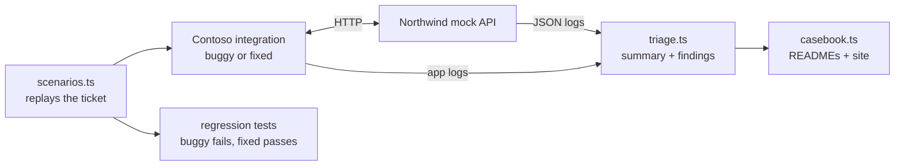

# API Support Casebook

Five API support tickets, each worked end to end: read the logs, find the root cause, unblock the customer, ship a fix with a regression test, and write the reply. The API, the customer's integration, the logs and the tests are real code you can run.

**[Read the casebook](https://jasontso2939.github.io/api-support-casebook/)** · [Support playbook](PLAYBOOK.md)

<!-- Hero GIF and walkthrough video go here. -->

## Why I built this

After a final-round interview for a customer success engineering role, the feedback was specific: I needed more hands-on API support experience. So I built the practice ground myself, modeled on the kind of insurance-data API I'd been preparing to support.

## What's in it

| Part | What it is |
| --- | --- |
| [`provider/`](provider/) | **Northwind Coverage API**, a mock insurance-data API: consent sessions, single-use authorization codes that expire in 10 minutes, environment-scoped keys, policy reads, per-client rate limits with `Retry-After`, signed webhooks, and a structured log line with a request ID for every call |
| [`customer/`](customer/) | **Contoso Rentals**, a customer's integration with Northwind, in its fixed state |
| [`tickets/`](tickets/) | Five tickets. Each has the code Contoso shipped (`buggy.ts`), the write-up, and the evidence |
| [`tools/triage.ts`](tools/triage.ts) | A log triage CLI: per-endpoint summary, errors, and findings for five known failure patterns, each citing request IDs |
| [`test/`](test/) | 18 tests: API behavior, the fixes, the detectors, and one regression test per ticket that fails on the shipped code |

Northwind, Contoso and everyone in the tickets are fictional.

## The tickets

| Ticket | Severity | What the customer saw | What it actually was |
| --- | --- | --- | --- |
| [TCK-1041](tickets/TCK-1041-sudden-401s/) | Sev 1 | Every insurance check fails with 401 after a deploy | Staging (sandbox) keys deployed to production |
| [TCK-1042](tickets/TCK-1042-connect-shows-failure/) | Sev 3 | "Couldn't connect" for renters who did connect | The callback exchanged one authorization code twice |
| [TCK-1043](tickets/TCK-1043-morning-429s/) | Sev 2 | The 9 a.m. job fails with 429s; "raise our limit" | All 300 requests in one instant, retries ignoring `Retry-After` |
| [TCK-1044](tickets/TCK-1044-webhooks-stopped/) | Sev 2 | Webhooks "stopped arriving" | Signature checked against re-serialized JSON, not the raw body |
| [TCK-1045](tickets/TCK-1045-wrong-vehicle/) | Sev 2 | "Your API returns the wrong car" | The customer's cache was keyed by account, not policy |

Every ticket follows the same shape: report, first response, scope and severity, investigation with the actual log rows, triage output, root cause, unblock, the fix as a diff, verification, the customer reply, an internal note, and what would prevent the next one. Every number in the write-ups comes from running the scenarios.

## How it works



## Decisions and tradeoffs

- **Real HTTP, not mocks of mocks.** The customer code calls the API over sockets, so headers, raw bodies, timing and rate limits behave like production. That's what made the webhook and rate-limit bugs reproducible.
- **Bugs a support engineer actually sees.** None of the five is an API defect. Each looks like one from the customer's side, which is the hard part of the job: proving where the problem is, kindly.
- **Unblock before root cause.** Each ticket records what got the customer working first.
- **Patterns become checks.** Every root cause became a detector in the triage tool, so the next occurrence is found from the logs in seconds. That's the path from recurring tickets to process to automation.
- **Codes never hit the logs.** Authorization codes are logged as a short fingerprint, so duplicates can be traced without storing secrets.
- **No dependencies.** TypeScript run directly by Node 22.18+, tested with `node:test`.

## Run it

```bash
npm test                                          # all 18 tests (about 35 seconds)
npm run repro -- TCK-1043 buggy                   # replay a ticket; logs go to runs/
npm run triage -- runs/TCK-1043/buggy/northwind.jsonl
npm run triage -- samples/TCK-1045/northwind.jsonl --customer samples/TCK-1045/contoso.jsonl
npm run casebook                                  # rebuild READMEs, samples and the site
```

## How it was built

Built with Claude Code. I designed the API's behavior, the five failure scenarios, the support process and the replies, and directed and reviewed the implementation.

## License

MIT
